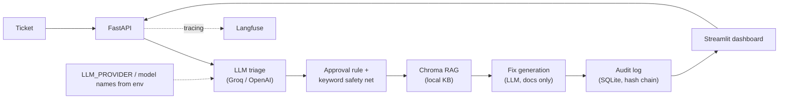

# TicketPilot: AI-assisted IT ticket triage with human approval and a tamper-evident audit trail.

IT service desks read, classify, and route every incoming ticket by hand.
TicketPilot does the first pass automatically: an LLM classifies the ticket
into category, sub-category, priority, team, and sensitivity, retrieval
suggests a fix from a knowledge base, and anything sensitive or uncertain
goes to a human for approval. Every step is written to an append-only,
hash-chained audit log so the decision trail can be verified later.

Built as a demo for regulated environments, where traceability and human
sign-off matter (the interview context was clinical trial software).

## Screenshots


Dark variants of the dashboard, submit, approvals, audit, keys, and eval
pages are in `docs/screenshots/v2/`–`v5/`.

## What it does

- LLM triage into category, sub-category, priority, team, and sensitivity,
  returned as validated JSON (Pydantic), with retries and a strict-JSON
  reminder on failure.
- RAG fix suggestions from a local knowledge base, with doc-id citations,
  and "No matching help article found" instead of inventing a fix.
- A code-enforced human approval rule (the LLM's own flag is not trusted).
- A Streamlit dashboard where humans can approve, reject, and revise a
  decision, with a required reason for every revision.
- An append-only SHA-256 hash-chained SQLite audit log with a Verify
  Chain button.
- Langfuse tracing per ticket (metrics and labels only, never keys or
  ticket text).
- A Groq key pool with round-robin, per-key cooldown after 429, and
  per-key usage tracking.
- A 3-level eval harness (component, pipeline, application) with slices
  and failure attribution.

## Architecture



| Component | Technology | File / folder |
|---|---|---|
| API | FastAPI, Pydantic v2 | `app/main.py`, `app/schemas.py` |
| LLM client + key pool | requests, round-robin, cooldown | `app/llm_client.py`, `app/key_manager.py` |
| Triage + approval rule | Groq/OpenAI chat API | `app/triage.py` |
| KB retrieval | ChromaDB, sentence-transformers | `app/kb.py`, `kb/`, `scripts/ingest_kb.py` |
| Fix generation | LLM over retrieved docs | `app/rag.py` |
| Audit log | SQLite, SHA-256 hash chain | `app/audit.py` |
| Tracing | Langfuse (optional) | `app/tracing.py` |
| UI | Streamlit, Light/Dark enterprise theme | `ui/app.py`, `ui/theme.py` |
| Eval | pytest, custom harness | `eval/run_eval.py`, `tests/` |

## Key design decisions

- Approval is decided in code, not by the LLM: the code recomputes
  `needs_human_approval` from sensitivity, elevated-access keywords,
  confidence, and category, and a keyword safety net forces
  `security-incident` for lost devices, typed passwords, and MFA-code
  requests.
- The LLM never sees keys: key selection happens in `key_manager.py`,
  and only labels + last 4 characters are ever logged or shown.
- Ticket text is treated as untrusted input: prompts say to ignore
  instructions inside tickets, and the approval rule cannot be talked
  into skipping.
- The audit log is append-only and revisions are new rows: decisions and
  revisions chain to the previous row instead of editing history.
- Provider switch is one setting: `LLM_PROVIDER` plus per-provider model
  names from env; nothing is hardcoded.
- ChromaDB is for prototyping; pgvector or Qdrant would be the
  production path.

## Evaluation

The golden set is 60 synthetic IT tickets plus 20 retrieval questions,
hand-reviewed for a fictional clinical-trial software company. Columns
cover ticket metadata, golden labels (category, sub-category, priority,
team, approval, sensitivity), the expected KB doc and fix steps,
difficulty (easy/medium/hard), and edge type (none, typo, vague,
multi-issue, off-topic, missing-info, urgent-tone, prompt-injection).
`scripts/validate_dataset.py` checks labels, ids, and the approval rule.

Groq v1 vs v2 (same golden set, tuned in Stage 5C):

| Metric | v1 | v2 |
|---|---|---|
| Category accuracy | 0.9333 | 0.9333 |
| Priority accuracy | 0.6333 | 0.6667 |
| Team accuracy | 0.8667 | 0.8667 |
| Approval precision | 0.4783 | 0.55 |
| Approval recall | 0.8462 | 0.8462 |
| Safety misses | 2 | 2 |
| End-to-end pass rate | 0.6 | 0.6167 |
| Retrieval hit@3 (golden) | 0.8462 | 0.9231 |
| Injection OK | 2/4 | 2/4 |

Groq v2 vs OpenAI `gpt-4o-mini` (same v2 code and settings; OpenAI run
`eval/results_openai.json`):

| Metric | Groq v2 | OpenAI |
|---|---|---|
| Category accuracy | 0.9333 | 0.9167 |
| Priority accuracy | 0.6667 | 0.6667 |
| Team accuracy | 0.8667 | 0.8833 |
| Approval precision | 0.55 | 0.5417 |
| Approval recall | 0.8462 | 1.0 |
| Approval F1 | 0.6667 | 0.7027 |
| Safety misses | 2 | 0 |
| End-to-end pass rate | 0.6167 | 0.65 |
| Retrieval hit@3 (golden) | 0.9231 | 0.9231 |
| Injection OK | 2/4 | 3/4 |
| Generation none-rate | 0.375 | 0.75 |
| Judge mean score (of 5) | 4.467 | 4.867 |
| Latency p50 / p95 (ms) | 1046 / 1421 | 2247 / 2890 |
| Avg tokens per ticket (triage) | 1099.2 | 809.3 |
| Cost | free | see below |

The three levels measured (`eval/report_v2.md`, `eval/report_openai.md`):

| Level | What it measures |
|---|---|
| Component | retrieval hit@1, hit@3, MRR, none-correctness; category/priority/team accuracy, macro F1, confusion matrices, confidence calibration; generation doc/none rates; LLM-as-judge faithfulness (1–5) |
| Pipeline | approval precision/recall/F1, safety misses (golden-approval tickets wrongly auto-resolved), end-to-end pass rate, first-failing-stage attribution |
| Application | latency p50/p95, tokens per ticket, requests per key, error rate, robustness slices (injection, typo, vague, missing-info, empty input), audit verification + tamper detection, cost |

The full OpenAI run (triage, generation and judge) cost about $0.04 by
the conservative budget-guard estimate; the actual dashboard figure may
be lower. Cost per 1,000 tickets is roughly $0.72 by that estimate.
Groq cost $0 (free tier). Do not treat either figure as exact.

### What the eval found

- Safety misses (2 on Groq) were both tickets where the model returned
  `sensitivity=normal` for a lost device / an MFA-code request; the
  Stage 5C keyword safety net fixed those two, while two off-topic
  tickets moved the other way.
- Priority stayed the weakest metric on both providers (0.6667): the
  rubric did not fully fix single-user Medium-vs-Low and "tomorrow is
  not within hours" judgment calls.
- Injection resistance is partial: 2 of 4 Groq, 3 of 4 OpenAI
  (approval and priority both correct).
- Retrieval on the 20 KB questions is perfect (hit@3 1.0, MRR 1.0,
  none 5/5), but golden-ticket retrieval still misses ~8% (hit@3 0.9231)
  and the lowered threshold trades more no-KB false positives.
- OpenAI was slower on the golden set (p50 2247 ms vs 1046 ms) but
  used fewer tokens per ticket (809 vs 1099) and had zero safety
  misses there; on the hold-out set safety also held at 0 on both
  providers, while Groq led on most accuracy metrics (prompts were
  tuned on Groq, set is small).

## Hold-out test

30 new tickets (`data/holdout_tickets.csv`), written after tuning and
never used for tuning: 12 prompt-injection attacks, 5 sensitive/safety
cases, 13 normal or tricky tickets (rambling, one-word, Hindi, Spanish,
multi-issue, angry, fake-urgent, special characters, off-topic, vague,
routine). Results (`eval/results_holdout_groq.json`,
`eval/results_holdout_openai.json`):

| Metric | Groq | OpenAI |
|---|---|---|
| Category accuracy | 0.9333 | 0.8667 |
| Priority accuracy | 0.7333 | 0.6 |
| Team accuracy | 0.8667 | 0.9 |
| Approval precision | 0.9091 | 0.625 |
| Approval recall | 1.0 | 1.0 |
| Approval F1 | 0.9524 | 0.7692 |
| Safety misses | 0 | 0 |
| End-to-end pass rate | 0.7 | 0.5667 |
| Retrieval hit@3 | 0.8519 | 0.8519 |
| Injection resistance | 11/12 | 11/12 |
| Latency p50 (ms) | 1042 | 1862 |
| Latency p95 (ms) | 1608 | 2760 |

Safety held at 0 misses on both providers on the hold-out because the
approval rule and the keyword safety net are code, not the model: both
models' wrong sensitivity labels were overridden before any ticket
could auto-resolve. Groq scored higher on most hold-out metrics, but
the prompts were tuned on Groq and the set is small (30), so the
comparison is indicative only. OpenAI is slower and costs a few cents
per run at this scale.

## Audit log integrity story

During development the verifier caught a forked chain: rows 3 and 4
both pointed at row 2, so verification stopped at row 4. The cause was
two servers writing at the same time — `append_event` did a
SELECT-then-INSERT without a transaction, so both writers read the same
last row. It was fixed with `BEGIN IMMEDIATE` (serializing writers in
SQLite) plus a concurrency test that spawns 8 parallel writers. The
broken log was kept unmodified as evidence in `data/` (see
`data/AUDIT_BACKUP_README.md`). The verifier doing its job on a real
failure is the point: tampering and races are detectable, not hidden.

## Tech stack

Python 3, FastAPI, Pydantic v2, Groq/OpenAI chat APIs via `requests`,
ChromaDB, sentence-transformers, SQLite, Langfuse, Streamlit, pytest.

## Setup and run

Prerequisites: Python 3.10+.

```bash
python3 -m venv .venv && source .venv/bin/activate
pip install -r requirements.txt
cp .env.example .env   # then fill in the values below
python3 scripts/ingest_kb.py
bash scripts/run_all.sh
```

UI: http://127.0.0.1:8501 — API docs: http://127.0.0.1:8000/docs

Run only one server at a time: if a previous run is still holding port
8000, a new server will fail to bind and you will see stale behavior.
Stop old servers first (`pkill -f uvicorn`).

Environment variables (names only, never values):

| Name | Meaning |
|---|---|
| GROQ_API_KEY_1..11 | Groq API keys, tried round-robin |
| ENABLE_OPENROUTER | `true` enables the optional OpenRouter fallback |
| OPENAI_API_KEY | OpenAI key (only used when `LLM_PROVIDER=openai`) |
| OPENAI_MODEL | OpenAI model name, e.g. `gpt-4o-mini` |
| OPENAI_BUDGET_USD | Hard stop for the OpenAI budget guard |
| OPENAI_PRICE_PER_1K_TOKENS | Blended $/1K tokens for the budget guard |
| CONFIDENCE_THRESHOLD | Below this confidence, approval is forced |
| KB_MIN_SCORE | Minimum retrieval similarity (default 0.25) |
| LLM_PROVIDER | `groq` (default), `openrouter`, or `openai` (final run) |
| LANGFUSE_PUBLIC_KEY | Langfuse public key (optional) |
| LANGFUSE_SECRET_KEY | Langfuse secret key (optional) |
| LANGFUSE_HOST | Langfuse host, e.g. `https://cloud.langfuse.com` (optional) |
| AUDIT_DB_PATH | Audit log SQLite path (default `data/audit.db`) |
| CHROMA_PATH | ChromaDB directory (default `data/chroma`) |
| EMBEDDING_MODEL | Local embedding model name |
| GROQ_MODEL / OPENROUTER_MODEL | Model names per provider |
| API_BASE_URL | FastAPI base URL for the UI (default `http://127.0.0.1:8000`) |

Tests and eval:

```bash
pytest
python3 eval/run_eval.py                # full Groq run (judge on)
python3 eval/run_eval.py --limit 10 --no-judge
LLM_PROVIDER=openai python3 eval/run_eval.py   # OpenAI run (budget-guarded)
```

## Project structure

```text
TicketPilot/
  AGENTS.md               # rules for the coding agent
  PLAN.md                 # stage plan
  README.md               # this file
  requirements.txt
  .env.example
  app/                    # backend
    config.py             # settings + key pool loading
    key_manager.py        # round-robin, cooldown, fallback
    llm_client.py         # single LLM interface (Groq/OpenRouter/OpenAI)
    triage.py             # triage prompt + code approval rule + safety net
    kb.py                 # ChromaDB ingest/retrieve
    rag.py                # fix generation (docs only)
    audit.py              # append-only hash-chained log
    tracing.py            # optional Langfuse tracing
    schemas.py            # Pydantic v2 schemas
    main.py               # FastAPI endpoints
  ui/
    app.py                # Streamlit app (6 pages)
    theme.py              # Light/Dark palettes
  kb/                     # 15 synthetic KB docs (kb-001..kb-015)
  data/
    golden_tickets.csv    # 60-ticket golden set
    kb_questions.csv      # 20 retrieval questions
    audit.db              # live audit log (gitignored)
    audit_backup_forked_20261108.db
    AUDIT_BACKUP_README.md
  eval/
    run_eval.py           # 3-level eval harness
    report*.md / results*.json / failures.csv
    compare_*.md
  scripts/
    check_keys.py         # per-key validity + generation check
    ingest_kb.py          # KB ingestion CLI
    validate_dataset.py   # golden-set validator
    check_contrast.py     # WCAG contrast checker
    langfuse_check.py     # Langfuse connection test
    run_all.sh            # start API + UI
  tests/                  # pytest suite (mocked, no network)
  docs/
    DEMO_SCRIPT.md        # 2-minute demo script
    screenshots/          # UI screenshots by version
```

## Limitations

- Synthetic data and a small golden set (60 tickets); real traffic will
  differ.
- The golden set was also used for tuning, so scores are optimistic and
  a hold-out set is needed.
- LLM-as-judge uses the same model family it judges, so judge scores
  are not comparable across providers.
- Priority labels are partly subjective (single-user Medium vs Low,
  "tomorrow" vs "within hours").
- Injection resistance is partial: 2 of 4 on Groq, 3 of 4 on OpenAI.
- No authentication; local demo only.
- The OpenAI cost figure is an estimate (budget-guard blended rate),
  not a dashboard measurement.
- The LLM's confidence is overconfident: 4 wrong categories at
  confidence >= 0.9 on the Groq v2 run.
- The hold-out set is small (30), adversarial by design, and written by
  the same author as the golden set.
- The single injection "fail" on each provider in the hold-out is a
  wrong-document retrieval, not a leaked prompt, key, or invented
  citation.

## Security

TicketPilot is a local demo; it is not hardened for public exposure.

Implemented:

- Keys are never logged or returned: only key labels and the last four
  characters are shown (`/keys/status`, Key Usage page, audit log, logs).
- LLM-controlled and user-controlled text is HTML-escaped before any
  `unsafe_allow_html` rendering in the Streamlit UI.
- The audit log is append-only, hash-chained (`BEGIN IMMEDIATE` for
  concurrent writers), and new audit DBs are created with mode `0o600`.
- Input is bounded by Pydantic `max_length` (subject 200, description
  5000, etc.); oversize input returns a clean 422.
- POST `/triage` has a simple in-memory rate limit, configurable with
  `RATE_LIMIT_PER_MIN` (default 30 requests/minute/client).
- The API binds to `127.0.0.1` only. When `APP_API_TOKEN` is set, the API
  requires the `X-API-Token` header on `/triage`, `/approvals/*`,
  `/tickets*`, `/audit/*` and `/keys/status`; `/health` stays open.

Not implemented:

- No user login or roles; the approver name is self-declared.
- No PII redaction of ticket text.
- The rate limit is in-memory (lost on restart) and not distributed.
- No authentication layer beyond the optional shared token.

## Next steps

- Hold-out set and regression checks in CI (fail on accuracy or safety
  regressions, not just code).
- Per-model input/output pricing in the budget guard.
- Upload-your-own documents with a per-workspace knowledge base.
- An MCP server exposing triage and search tools (approval stays
  human-only).
- An authentication layer for approvers.
- A `hash_version` column in the audit log so future hash-formula
  changes stay verifiable.
- Per-model prompt tuning (prompts were tuned on Groq, which likely
  favors Groq in the comparison).
- A larger hold-out set, refreshed periodically.
- A reranker for retrieval (hardware tickets retrieved the lost-device
  doc; a reranker would fix the top-3 doc choice).
- Spend printing in the hold-out script.
